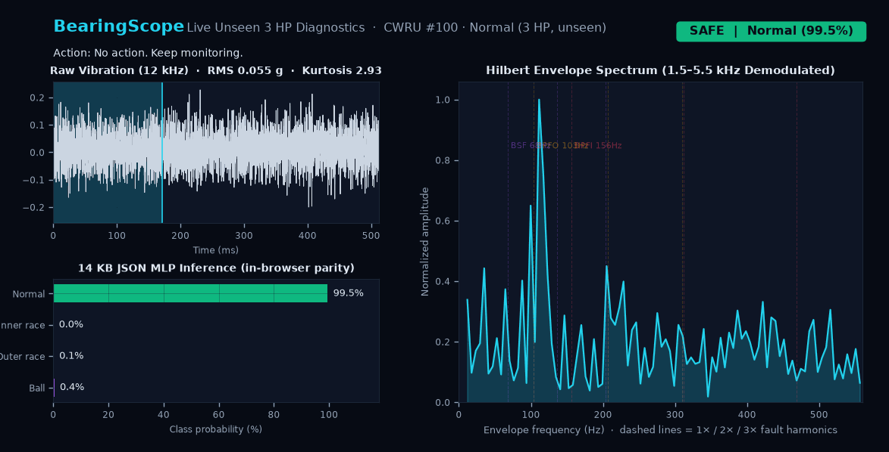
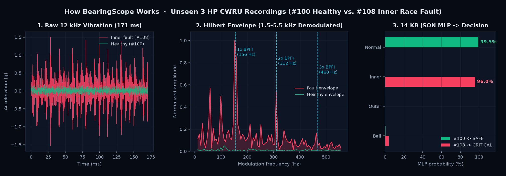
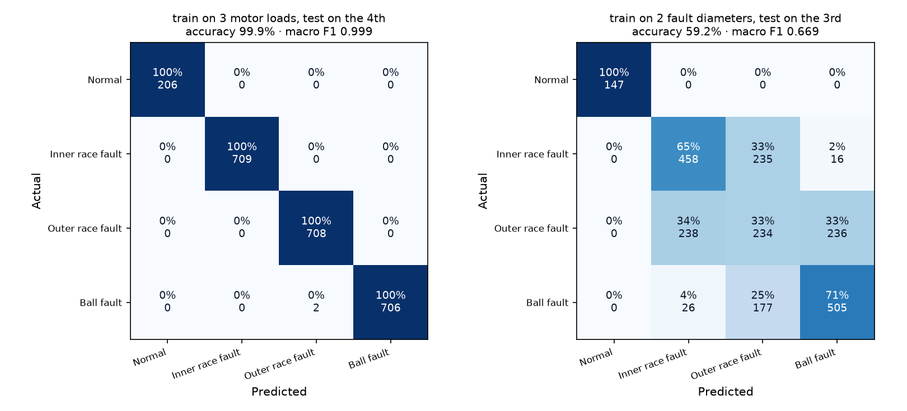

<h1 align="center">BearingScope — Live Explainable Bearing-Fault Diagnosis</h1>

<p align="center">
  <a href="https://aryanhood.github.io/shm-bearing-dataset/"></a>
  <a href="https://github.com/aryanhood/shm-bearing-dataset/actions/workflows/ci.yml"></a>
  
  
  
</p>

<p align="center">
  <b>Raw 12 kHz Vibration → Hilbert Envelope Physics → <code>SAFE</code> / <code>WATCH</code> / <code>CRITICAL</code></b><br>
  Real-time rotating-machinery diagnostics trained on the <a href="https://engineering.case.edu/bearingdatacenter">CWRU Bearing Dataset</a> and compiled to a 14 KB JSON model running <b>100% in your browser</b> with zero backend.
</p>

<p align="center">
  <b><a href="https://aryanhood.github.io/shm-bearing-dataset/">Open Live Interactive Studio →</a></b>
</p>

---

## 1. Output First (`Raw Vibration` → `Live Diagnosis`)

Stream unseen **3 HP CWRU drive-end recordings** (or drop in your own 12 kHz `.csv`) and watch BearingScope demodulate the signal, lock onto the physical defect harmonics (`BPFI`, `BPFO`, `BSF`), and emit a maintenance verdict in real time:

<p align="center">
  
</p>

- **Zero leakage in the live demo:** the deployed model is trained strictly on motor loads **0, 1, and 2 HP**. Every recording streamed in the animation and on the [live web studio](https://aryanhood.github.io/shm-bearing-dataset/) comes from the held-out **3 HP** operating condition.
- **Bit-exact browser inference:** the FFT, Hilbert envelope demodulator, 16-feature extractor, and MLP forward pass run directly in TypeScript (`web/src/lib/`) and are verified in CI to match Python within `1e-6` relative tolerance.

---

## 2. How It Works (In 3 Simple Steps)

When a rolling element strikes a microscopic spall on a bearing race, it rings the housing like a bell inside a high-frequency structural resonance (`1.5–5.5 kHz`). BearingScope turns that physical signature into a decision in three stages:

<p align="center">
  
</p>

1. **Window the 12 kHz signal (`bearingscope/data.py`):** slice non-overlapping `2048`-sample windows (`171 ms`) from the drive-end accelerometer. Normal baseline recordings (`48 kHz` in CWRU) are zero-phase decimated by `4×` to match the `12 kHz` fault rate.
2. **Demodulate the envelope & extract 16 features (`bearingscope/features.py`):** band-pass `1.5–5.5 kHz`, compute the analytic Hilbert envelope, and measure local peak-to-ring SNR at the `1×`, `2×`, and `3×` harmonics of the SKF 6205-2RS kinematic defect frequencies (`BPFI = 5.415×`, `BPFO = 3.585×`, `BSF = 2.357×` shaft speed), combined with 5 time-domain shape stats and 8 spectral band energies.
3. **Classify & apply maintenance policy (`bearingscope/model.py`, `bearingscope/decision.py`):** run a `StandardScaler → MLP(32, ReLU) → Softmax` model (`14 KB` JSON) and map class probabilities into an actionable status:
   - `SAFE` — Normal probability `≥ 0.80` → *No action. Keep monitoring.*
   - `CRITICAL` — Specific fault probability `≥ 0.80` → *Schedule bearing replacement.*
   - `WATCH` — Ambiguous window → *Re-check at shorter interval.*

---

## 3. Honest Benchmark (No Window Leakage)

Randomly splitting overlapping windows from the same CWRU recording inflates accuracy toward `100%` because adjacent windows are nearly identical. Instead, BearingScope evaluates on **2,331 non-overlapping windows across all 40 real CWRU recordings** using two strictly recording-grouped protocols:

| Protocol | Split | Accuracy | Macro F1 | Normal Recall | What it tests |
|---|---|---:|---:|---:|---|
| **Unseen motor load** | 4-fold (train 3 loads, test 4th) | **99.91%** | **0.999** | 100.0% | Generalizing to a new RPM / torque load |
| **Unseen fault size** | 3-fold (train 2 diameters, test 3rd) | **59.15%** | **0.669** | 100.0% | Generalizing to a defect size never seen in training |

<p align="center">
  
</p>

**Why show the harder `59.2%` test?** Because it reveals the real engineering boundary: healthy vs. faulty detection stays **100% separable** even on unseen defect diameters, while distinguishing *which* fault occurred degrades when spall geometry (`0.007"` → `0.014"` → `0.021"`) shifts the structural resonance band. Full metrics live in [`artifacts/metrics.json`](artifacts/metrics.json) and the design tradeoffs are documented in [`docs/adr/`](docs/adr/).

---

## 4. Quick Start

### Python CLI (Download real CWRU data, evaluate, train, predict)

```bash
pip install -e ".[dev]"

# 1. Download the 40 real CWRU 12 kHz drive-end recordings (~120 MB)
bearingscope download

# 2. Run both grouped cross-validation benchmarks & regenerate confusion matrix
bearingscope evaluate

# 3. Train on 0-2 HP and export the 14 KB browser model + 3 HP demo stream
bearingscope train

# 4. Run CLI diagnosis on any single-column 12 kHz CSV
bearingscope predict path/to/vibration.csv --rpm 1750
```

### Live Interactive Web Studio (`web/`)

```bash
cd web
npm install
npm run dev
```

Open `http://localhost:5173` to stream unseen 3 HP CWRU recordings, scrub the 2048-sample analysis window, inspect live `BPFI`/`BPFO`/`BSF` envelope harmonics, or upload your own 12 kHz `.csv`.

---

## 5. Repository Structure

```text
shm-bearing-dataset/
├── bearingscope/            # Python package: physics, Hilbert features, MLP, grouped eval, CLI
├── tests/                   # Fast unit, integration, CLI & golden-parity tests (no .mat needed)
├── web/                     # Zero-backend React 19 + TypeScript live diagnostics studio
│   ├── src/lib/             # Bit-exact TS port (radix-2 FFT, envelope, MLP, decision + parity tests)
│   └── public/data/         # Exported 14 KB model.json + unseen 3 HP demo.i16 stream
├── artifacts/               # Reproducible metrics.json and exported model.json
├── assets/                  # Live demo GIF, 3-step physics visual, confusion matrices
├── docs/                    # Architecture overview and ADRs (0001–0003)
└── .github/workflows/       # CI (Python 3.11–3.13 + Node 22) and automatic GitHub Pages deploy
```

---

## 6. Verification & Quality Gates

```bash
make check
```

| Layer | Tooling | Gate |
|---|---|---|
| Python lint & format | `ruff check` + `ruff format --check` | Zero warnings |
| Python typing | `mypy --strict` | Zero errors across all source & test files |
| Python tests | `pytest --cov=bearingscope` | Unit, grouped CV, CLI & golden-fixture parity |
| Web studio | `tsc --noEmit`, `biome check`, `vitest`, `vite build` | Zero warnings, `< 1e-6` Python↔TS parity, production bundle verified |
| Live deployment | GitHub Actions → GitHub Pages (`deploy.yml`) | Auto-deploys `web/dist` on every push to `main` |

---

## References

- **Dataset:** Case Western Reserve University (CWRU) Bearing Data Center — 12 kHz Drive-End & Normal Baseline SKF 6205-2RS JEM recordings ([engineering.case.edu/bearingdatacenter](https://engineering.case.edu/bearingdatacenter)).
- **Method:** Robert B. Randall & Jérôme Antoni, *"Rolling element bearing diagnostics—A tutorial,"* Mechanical Systems and Signal Processing (2011).

MIT License — see [LICENSE](LICENSE).
