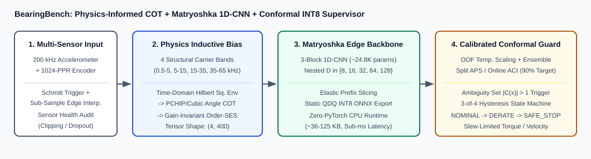
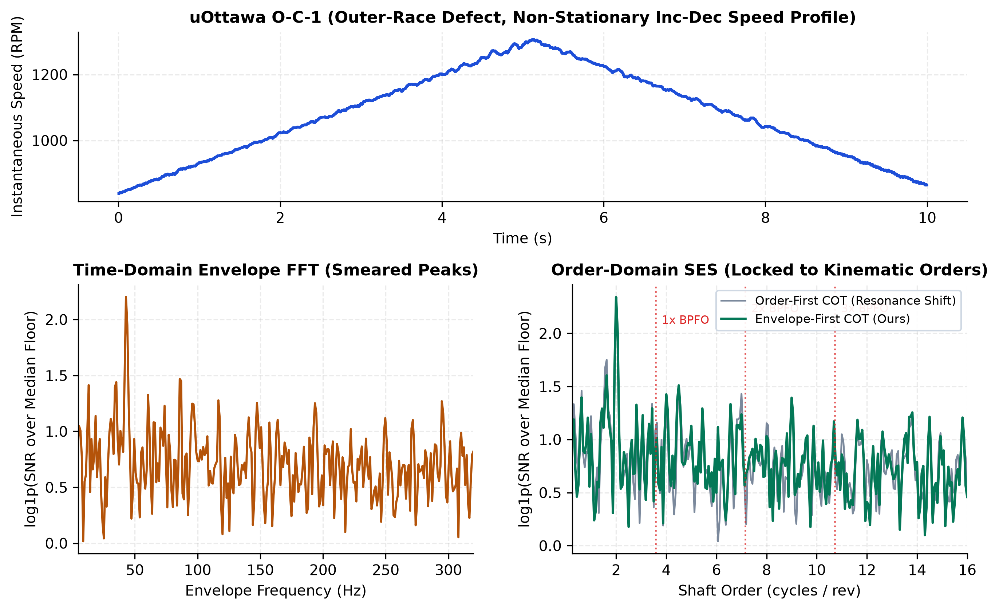
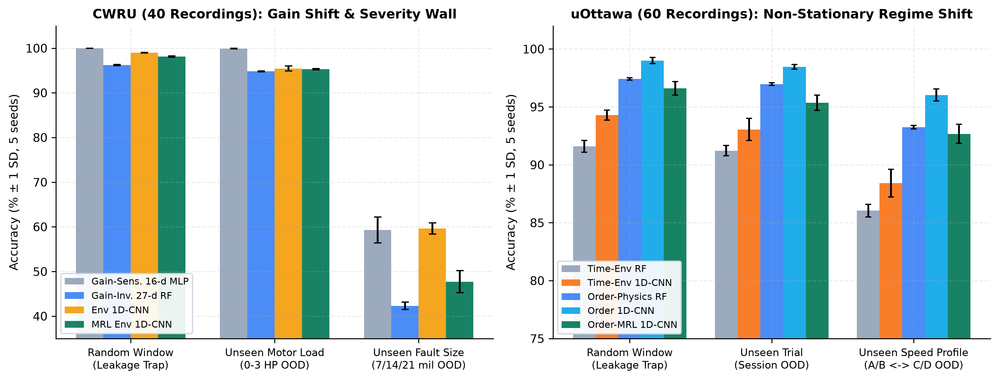
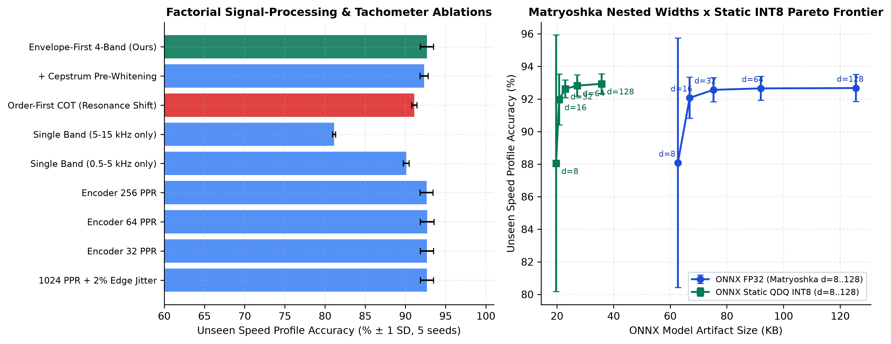
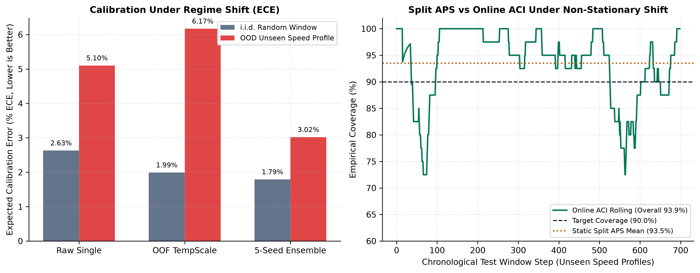
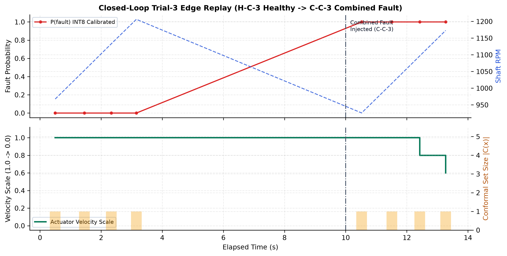

# BearingBench — Motor Health Check & Edge ML

> **[Technical Report (PDF)](paper/technical_report.pdf)** · **[Browser App (`web/`)](web/)** · **[C++20 Edge CLI (`cpp/`)](cpp/)** · **[Reproducible Results JSON](artifacts/benchmark_results.json)**

### What It Does (In Plain English)

- **Real-world problem:** Factory motors speed up and slow down all day. Normal vibration AI gets fooled when motor RPM changes—and standard ISO 20816-3 plant meters miss early bearing wear completely (**36/36** CWRU faults sit inside "safe" Zone A).
- **What this builds:** Resamples vibration signals by **shaft rotation angle** instead of clock time, shrinks a width-elastic CNN (`MatryoshkaOrderCNN`) into a **35.77 KB INT8 ONNX** model, wraps decisions in online uncertainty bounds, and ships as a **browser web app (`web/`)**, a **native C++20 CLI (`cpp/`)**, and a **Python edge package**.
- **Measured results:** Tested across **100 real lab recordings** (CWRU & uOttawa, 5 seeds), angular order tracking boosts accuracy on unseen speed ramps from **88.41% to 96.02%** (`p < 1e-10`), while the C++20 runner matches Python (`5/5` classes, `4.43e-9` worst prob diff) at **`46.6 µs` p50 (`0.0466 ms`)** single-thread CPU latency.

### Three Ways to Run It Right Now

1. **Interactive Browser App (`web/`) — runs `order_mrl_int8.onnx` directly in WebAssembly + accepts `.csv`/`.wav` files:**
   ```bash
   cd web && npm install && npm run check && npm run dev
   ```
2. **Native C++20 Edge CLI (`cpp/`) — zero-Python ONNX Runtime runner (`46.6 µs` p50 CPU):**
   ```bash
   python scripts/fetch_onnxruntime.py
   cmake -S cpp -B cpp/build -DCMAKE_BUILD_TYPE=Release && cmake --build cpp/build --parallel
   ./cpp/build/bearingbench-edge --model artifacts/order_mrl_int8.onnx --verify-ref cpp/test_data/reference_windows.csv --runs 500
   ```
3. **Python Edge Runtime (zero PyTorch):** see [Section 7](#7-one-command-reproducibility--verification) below.



---

## 1. Key Findings & Technical Summary

1. **Order-Domain Physics Outperforms Time-Domain Learning Across Unseen Speed Regimes:** On uOttawa `unseen_speed_profile` (train monotonic ramps `A/B` &harr; test reversing profiles `C/D`), order-domain 1D-CNN reaches **`96.02% ± 0.52%`** vs. **`88.41% ± 1.19%`** for time-domain envelope CNN (`+7.61 pp`, 95% pooled bootstrap CI `[+6.61, +8.58] pp`, exact McNemar `305 vs. 39`, `p < 1e-10`). Extracting 4-band structural Hilbert envelopes *before* angular resampling (**Envelope-First COT**) outperforms Order-First resampling (`92.67%` vs. `91.10%`, `+1.57 pp`, `p = 0.000128`).
2. **Kilobyte-Scale Elastic INT8 Deployment (Zero PyTorch Runtime):** Training a single `MatryoshkaOrderCNN` across nested channel widths `d in {8, 16, 32, 64, 128}` and applying physical prefix slicing + proper-train-calibrated static QDQ INT8 quantization shrinks the `d=128` ONNX model `3.51x` to **`35.77 KB`** at **`92.93% ± 0.60%`** accuracy (`0.1205 ms` p50 CPU latency, `1.62e-5` max Torch/ONNX logit diff), while `d=16` INT8 achieves **`91.96% ± 1.56%`** in **`20.78 KB`** and `d=8` INT8 reaches **`88.04% ± 7.88%`** in **`19.71 KB`**.
3. **Zero-Label Carrier Drift vs. ISO 20816-3:** Standard ISO 20816-3 velocity RMS (`10–1000 Hz`) masks **36/36** CWRU faults inside Zone `A` (`40/40`), whereas our zero-label Median/MAD carrier-band drift score yields **`1.0000` AUROC / `1.0000` AUPRC** on CWRU and **`0.9097` AUROC / `0.9739` AUPRC** on unseen uOttawa speed profiles `C/D`.
4. **Uncertainty Shift & Online Conformal Recovery:** Under non-stationary shift, raw single-model ECE doubles (`2.63% -> 5.10%`) and ID-tuned out-of-fold Temperature Scaling worsens OOD ECE (`6.17%`), while 5-seed ensembling halves OOD ECE to **`3.02%`**. Online Adaptive Conformal Inference (ACI) sustains **`93.93%`** (`unseen_speed_profile`) and **`96.25%`** (`unseen_trial`) coverage at 90% target and recovers **`+22.88 pp`** coverage (`50.16% -> 73.04%`) when unseen CWRU spall diameters break exchangeability.

---

## 2. Physics-Informed Computed Order Tracking



When shaft speed accelerates and decelerates continuously (uOttawa `O-C-1`, `840 <-> 1300 RPM`), bearing impact frequencies stretch across Hz bins. Bandpass-filtering into four structural resonance carriers (`0.5–5`, `5–15`, `15–35`, `35–65 kHz`) *before* Hilbert squaring and cubic/PCHIP shaft-angle resampling locks spectral peaks cleanly onto kinematic shaft orders (`k x BPFO`).

---

## 3. Dual-Dataset Leak-Free Benchmark (`5 Seeds`, `Mean ± Std`)



### CWRU (`40` Recordings, `2,331` Windows, `4` Classes)

| Model / Representation | `random_window` (Leakage) | `unseen_load` (0–3 HP OOD) | `unseen_fault_size` (7/14/21 mil OOD) |
|---|---:|---:|---:|
| Gain-Sensitive 16-d MLP | `99.98% ± 0.02%` | `99.90% ± 0.04%` | `59.29% ± 2.90%` *(14 mil: 33.40%)* |
| Gain-Invariant 27-d RF | `96.20% ± 0.12%` | `94.83% ± 0.10%` | `42.32% ± 0.83%` |
| Envelope 1D-CNN | `99.00% ± 0.08%` | `95.44% ± 0.56%` | `59.63% ± 1.22%` |
| MRL Envelope 1D-CNN (`d=128`) | `98.14% ± 0.12%` | `95.29% ± 0.15%` | `47.72% ± 2.47%` |

### uOttawa (`60` Recordings, `699` Windows, `5` Classes)

| Model / Representation | `random_window` | `unseen_trial` (Group OOD) | `unseen_speed_profile` (A/B &harr; C/D OOD) | Ball Fault Recall |
|---|---:|---:|---:|---:|
| Time-Envelope RF | `91.59% ± 0.50%` | `91.22% ± 0.45%` | `86.04% ± 0.55%` | `63.62%` |
| Time-Envelope 1D-CNN | `94.28% ± 0.43%` | `93.05% ± 0.95%` | `88.41% ± 1.19%` | `77.97%` |
| Order-Physics RF (27-d) | `97.42% ± 0.10%` | `96.97% ± 0.12%` | `93.25% ± 0.16%` | `75.51%` |
| **Order 1D-CNN** | **`99.00% ± 0.27%`** | **`98.46% ± 0.21%`** | **`96.02% ± 0.52%`** | **`84.49%`** |
| Order-MRL 1D-CNN (`d=128`) | `96.60% ± 0.59%` | `95.36% ± 0.66%` | `92.67% ± 0.83%` | `82.61%` |

### Paired Statistical Significance (`unseen_speed_profile`, Pooled 5-Seed Windows)

| Comparison | Mean Accuracy Delta | 95% Bootstrap CI | Exact McNemar (`n_A / n_B`) | Two-Sided p-Value |
|---|---:|---:|---:|---:|
| `Order-CNN` vs. `Time-Env CNN` | **`+7.61 pp`** | `[+6.61, +8.58] pp` | `305 / 39` | **`0.0`** (`< 1e-10`) |
| `Envelope-First` vs. `Order-First COT` | **`+1.57 pp`** | `[+0.80, +2.35] pp` | `128 / 73` | **`0.000128`** |
| `Order-MRL CNN` vs. `Order-Physics RF` | `-0.57 pp` | `[-1.40, +0.31] pp` | `110 / 130` | `0.219951` |

---

## 4. Factorial Ablations & Matryoshka ONNX INT8 Pareto Frontier



| Variant / Width (`unseen_speed_profile`, 5 seeds) | FP32 Acc (`±SD`) | INT8 Acc (`±SD`) | FP32 -> INT8 Size | INT8 p50 Latency | INT8 OOD ECE |
|---|---:|---:|---:|---:|---:|
| Sliced Matryoshka `d = 8` | `88.07% ± 7.66%` | **`88.04% ± 7.88%`** | `62.69 -> 19.71 KB` | `0.1045 ms` | `0.1802` |
| Sliced Matryoshka `d = 16` | `92.07% ± 1.26%` | `91.96% ± 1.56%` | `66.88 -> 20.78 KB` | `0.1908 ms` | `0.0525` |
| Sliced Matryoshka `d = 32` | `92.56% ± 0.74%` | `92.62% ± 0.55%` | `75.26 -> 22.92 KB` | `0.2238 ms` | **`0.0265`** |
| Sliced Matryoshka `d = 64` | `92.65% ± 0.73%` | `92.82% ± 0.66%` | `92.01 -> 27.21 KB` | **`0.0763 ms`** | `0.0425` |
| Sliced Matryoshka `d = 128` | `92.67% ± 0.83%` | **`92.93% ± 0.60%`** | `125.52 -> 35.77 KB` | `0.1205 ms` | `0.0514` |

Single-factor ablation highlights on `unseen_speed_profile`:
- **Single-Band Drops:** `0.5–5 kHz` (`90.10%`), `5–15 kHz` (`81.14%`), `15–35 kHz` (`65.49%`) vs. 4-band fusion (`92.67%`).
- **Cepstrum Pre-Whitening:** `92.33% ± 0.51%` (slightly below un-whitened `92.67%`).
- **Tachometer Resolution & Edge Jitter:** Downsampling from `1024 PPR` to `256 / 64 / 32 PPR` or injecting `2%` edge timing jitter maintains `92.64%–92.70%` because `32 PPR` still supplies 64 smoothed edges per 2-revolution window.

---

## 5. Calibration Under Shift, Conformal Prediction & Closed-Loop Edge Replay



| Protocol | Raw Single ECE | OOF TempScale ECE | 5-Seed Ensemble ECE | Split APS Coverage | Online ACI Coverage | ACI Set Size |
|---|---:|---:|---:|---:|---:|---:|
| uOttawa `random_window` | `2.63%` | `1.99%` | `1.79%` | `97.38%` | `97.04%` | `1.011` |
| uOttawa `unseen_trial` | `3.04%` | `2.69%` | `1.98%` | `97.05%` | **`96.25%`** | `1.024` |
| uOttawa `unseen_speed_profile` | `5.10%` | `6.17%` | **`3.02%`** | `93.53%` | **`93.93%`** | `1.070` |
| CWRU `unseen_load` | `3.13%` | `2.38%` | **`2.05%`** | `96.88%` | `95.71%` | `1.016` |
| CWRU `unseen_fault_size` | `48.88%` | `47.05%` | `43.96%` | `50.16%` | **`73.04%`** | `1.836` |



On continuous Trial-3 replay (`H-C-3` healthy reversing `967 -> 1206 RPM` followed by `C-C-3` combined fault), the `35.77 KB` INT8 `EdgeClassifier` + `SupervisoryController` produces **`0` false derates** over all healthy windows and triggers slew-limited **`SAFE_STOP`** at `t = 12.425 s`.

---

## 6. Negative Results & Failure Modes

1. **Unseen Fault Severity Wall (CWRU `7/14/21 mil`):** Held-out spall diameters drop supervised accuracy to `47.72%–59.63%` (`14 mil` MLP fold: `33.40%`). Changes in spall geometry alter structural modulation bandwidth rather than signal gain, defeating both gain-invariant normalization and MRL compression.
2. **Split Conformal Breakdown & Finite-Step ACI Lag:** Split APS violates exchangeability under CWRU severity shift (`50.16%` coverage); Online ACI improves coverage by `+22.88 pp` (`73.04%`), yet finite-horizon $\gamma = 0.05$ step updates lag abrupt domain shifts below the `90%` nominal target.
3. **ID-Tuned Temperature Scaling Under OOD Shift:** Proper-train OOF temperature scaling slightly *worsens* uOttawa unseen-speed ECE (`5.10% -> 6.17%`) and NLL (`0.4472 -> 0.7656`), confirming prior shift-calibration findings relative to 5-seed ensembles (`3.02%` ECE).
4. **Matryoshka Width Cliff at `d=8` & CPW Sideband Attenuation:** `d=8` shows high cross-seed variance (`±7.88%`) and `0.1802` ECE relative to `d >= 16` (`20.78 KB`), while cepstrum pre-whitening slightly attenuates weak ball-defect harmonics (`80.44%` vs. `82.61%` recall).

---

## 7. One-Command Reproducibility & Verification

```bash
pip install -e ".[ml,dev]"

# Reproduce all 100 .mat experiments, ONNX INT8 artifacts, and figures
python scripts/reproduce.py

# Verify README, LaTeX, and HTML metrics match artifacts/benchmark_results.json verbatim
python scripts/verify_report_numbers.py

# Lint, format check, strict type check, and unit/invariant test suite
ruff check .
ruff format --check .
mypy
pytest tests --cov=bearingbench

# Zero-PyTorch / Zero-Scikit-Learn ONNX edge runtime check
pip install -e .
python -c "from pathlib import Path; import numpy as np; from bearingbench.edge.onnx_edge import EdgeClassifier; print(EdgeClassifier(Path('artifacts/order_mrl_int8.onnx'), Path('artifacts/order_mrl_meta.json')).predict_proba(np.zeros((1,4,400), np.float32)))"
```

---

## Citation

```bibtex
@techreport{hood2026bearingbench,
  author      = {Aryan Hood},
  title       = {BearingBench: Physics-Informed Order-Domain Inductive Bias, Matryoshka Compression, and Conformal Uncertainty Under Non-Stationary Sensor Shift},
  institution = {Independent Systems Research},
  year        = {2026},
  url         = {https://github.com/aryanhood/shm-bearing-dataset/blob/main/paper/technical_report.pdf}
}
```

MIT License
