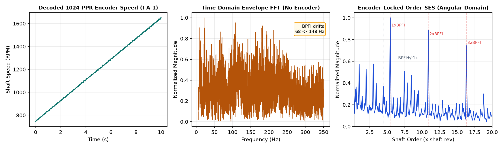
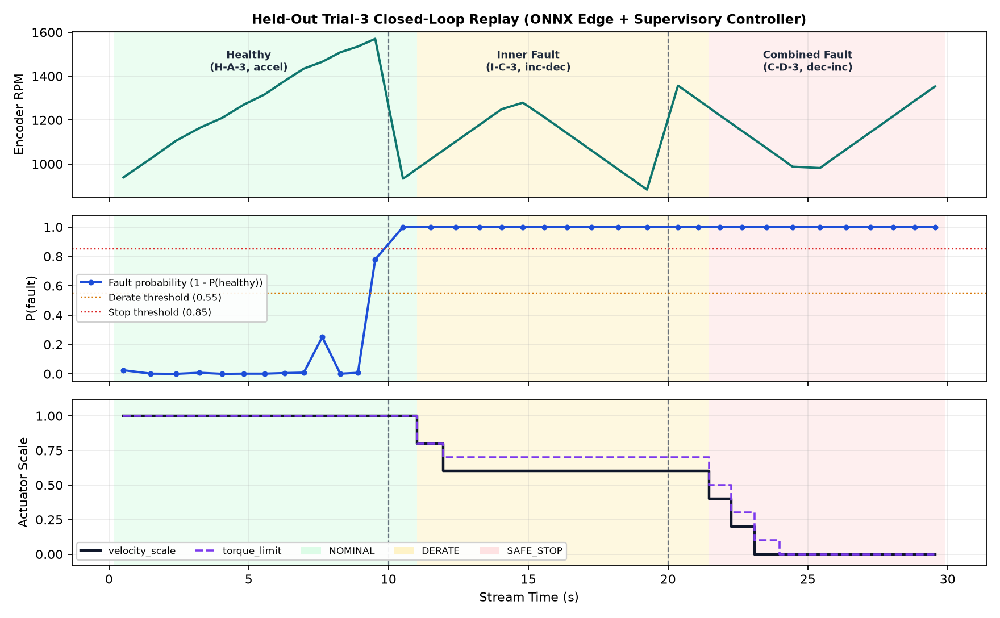
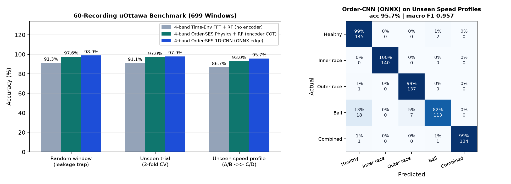
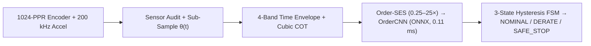

<h1 align="center">orderguard</h1>

<p align="center">
  Encoder-locked Computed Order Tracking, ONNX edge diagnostics, and hysteresis supervisory derating for variable-speed rotating actuators.
</p>

<p align="center">
  <a href="https://github.com/aryanhood/shm-bearing-dataset/actions/workflows/ci.yml"></a>
  
  <a href="LICENSE"></a>
</p>

---

## Output & Proof

Fixed-speed FFT vibration models break on variable-speed actuators. When shaft speed ramps from **747 to 1,650 RPM** (`I-A-1`), an inner-race defect (`BPFI = 5.428×`) drifts continuously from **68 Hz to 149 Hz**, smearing across a standard time-domain spectrum. Locking onto a **1024-PPR rotary encoder** collapses those smeared harmonics back onto sharp kinematic shaft orders (`1×/2×/3× BPFI` and `BPFI ± 1×` load-zone sidebands):



### Closed-Loop Supervisory Replay (Unseen Trial 3)

Trained strictly on Trials 1–2 (`458` windows), exported to a single **`256 KB` ONNX** graph (`59,245` params, `8.32e-07` PyTorch↔ONNX max probability diff, **`0.105 ms` p50 / `0.141 ms` p99** single-thread CPU latency), and replayed across three held-out Trial-3 recordings (`H-A-3 → I-C-3 → C-D-3`):



| Segment | Motion & Health | Controller Behavior | Actuator Limits |
|---|---|---|---|
| `0–10 s` (`H-A-3`) | Healthy, accelerating (`939 → 1,570 RPM`) | Rejects single `0.78` transient spike at `9.52 s` via `3-of-4` dwell | `NOMINAL` (`vel=1.00`, `trq=1.00`) |
| `10–20 s` (`I-C-3`) | Inner-race fault, up-down ramp | Enters derate at `11.50 s` without triggering unnecessary E-stop | `DERATE` (`vel=0.60`, `trq=0.70`) |
| `20–30 s` (`C-D-3`) | Combined multi-defect fault, down-up ramp | Escalates at `21.85 s` and slews actuator scales to zero | `SAFE_STOP` (`brake=True`) |

### 60-Recording Generalization Benchmark

Evaluated across all **60 uOttawa recordings** (`699` non-overlapping `16`-revolution windows, 5 health classes, 4 speed profiles, 3 trials) using identical four-band demodulation and amplitude-invariant noise-floor SNR normalization:

| Protocol | `time_env_rf` (no encoder) | `order_physics_rf` (COT) | `order_cnn_onnx` (COT + ONNX) |
|---|---:|---:|---:|
| `random_window` (5-fold) | 91.3% (F1 0.911) | 97.6% (F1 0.976) | **98.9%** (F1 0.989) |
| `unseen_trial` (3-fold grouped) | 91.1% (F1 0.910) | 97.0% (F1 0.970) | **97.9%** (F1 0.979) |
| `unseen_speed_profile` (A/B ↔ C/D) | 86.7% (F1 0.864) | 93.0% (F1 0.928) | **95.7%** (F1 0.957) |



Under unseen speed profiles (`A/B ↔ C/D`), encoder-locked Order-SES adds **+9.0 points** over the encoder-free time-envelope baseline, hitting `98.6%` recall on Healthy, `100.0%` Inner, `99.3%` Outer, `98.5%` Combined, and `81.9%` Ball.

---

## How It Works



- **Instrumentation & audit ([`encoder.py`](orderguard/encoder.py)):** Hysteresis Schmitt trigger (`35% / 65%` voltage span) with sub-sample midpoint interpolation tracks instantaneous RPM and audits both channels for dropouts, rail clipping, or out-of-range speed before inference.
- **Envelope-first COT ([`order_tracking.py`](orderguard/order_tracking.py), [`features.py`](orderguard/features.py)):** Demodulates four structural bands (`0.5–5`, `5–15`, `15–35`, `35–65 kHz`) in the time domain where housing resonances stay stationary in Hz, applies a `750 Hz` anti-aliasing low-pass, resamples onto `128` samples/rev via PCHIP/cubic splines, and normalizes each `16`-rev Order-SES against its median floor (`log1p(S / median(S))`).
- **Edge inference ([`model.py`](orderguard/model.py), [`edge.py`](orderguard/edge.py)):** Compact `OrderCNN` exported to a self-contained single-file ONNX graph (`artifacts/orderguard.onnx`), running on CPU via `onnxruntime` with zero PyTorch dependency at runtime.
- **Supervisory control ([`supervisor.py`](orderguard/supervisor.py)):** `3-of-4` confirmation window, sensor-fault fail-safe, and slew-rate-limited `velocity_scale` / `torque_limit` outputs prevent transient flicker from triggering false stops.

---

## Build & Run Locally

### Edge Inference Only (No PyTorch)

Uses the versioned `256 KB` ONNX artifact directly:

```bash
pip install -e .
orderguard inspect path/to/recording.mat
```

### Full Local Rebuild From Raw Data

Downloads the 60 uOttawa `.mat` recordings (`~730 MB`, SHA-256 verified) from Mendeley Data and regenerates every artifact, benchmark metric, replay trace, and figure:

```bash
pip install -e ".[train,dev]"
make rebuild   # runs: orderguard download -> train -> benchmark -> replay -> plots
make check     # runs: ruff check, ruff format --check, mypy --strict, pytest --cov
```

Python API:

```python
from pathlib import Path
from orderguard.data import load_mat_file
from orderguard.edge import EdgeClassifier
from orderguard.encoder import audit_sensors, decode_encoder
from orderguard.features import extract_multiband_cnn_input
from orderguard.order_tracking import multiband_order_envelopes, slice_order_windows

rec = load_mat_file(Path("data/uottawa/I-A-1.mat"))
track = decode_encoder(rec.encoder, rec.fs_hz)
assert audit_sensors(rec.vibration, track).ok
_, order_sigs = multiband_order_envelopes(rec.vibration, rec.fs_hz, track)
band_wins = [slice_order_windows(s)[0][0] for s in order_sigs]
probs = EdgeClassifier(Path("artifacts/orderguard.onnx")).predict_proba(
    extract_multiband_cnn_input(band_wins)
)
```

---

## Repository Layout & Notes

```text
shm-bearing-dataset/
├── orderguard/            # Core library: kinematics, data, encoder, COT, features, ONNX edge, FSM, CLI
├── tests/                 # Synthetic chirp, COT, ONNX parity, FSM & split-leakage unit tests (no .mat needed)
├── artifacts/             # Versioned ONNX model (256 KB), model metadata, benchmark.json, replay_trace.json
├── assets/                # Figures generated from the real uOttawa recordings
├── .github/workflows/ci.yml
├── Makefile
└── pyproject.toml         # data/ (~730 MB raw .mat downloads) is gitignored and fetched via `orderguard download`
```

- **Why multi-band envelopes instead of single-band CPW:** A single `1–40 kHz` cepstrum pre-whitened filter flattened weak outer-race housing resonances (`O-A-1` BPFO SNR fell from `2.76×` in `0.5–5 kHz` to `1.25×` under CPW), and per-window z-scoring amplified noise floor fluctuations in healthy windows. Separating four carrier bands and scaling by median noise floor fixed healthy↔outer confusion.
- **Why raw broadband FFT was excluded as a baseline:** In uOttawa each physical bearing stayed mounted across all four speed profiles, allowing raw `0–40 kHz` FFT bands to memorize the static test-rig transfer function (`94.9%` across `A/B ↔ C/D`) rather than defect kinematics.
- **Ball fault recall (`81.9%`):** Rolling-element defects move in and out of the radial load zone at cage speed (`FTF`), making impulses intermittent inside `16`-revolution windows.

**References:** Huang & Baddour (*Data in Brief*, 2018; [Mendeley Data](https://data.mendeley.com/datasets/v43hmbwxpm/2)) · Randall & Antoni (*MSSP*, 2011) · Borghesani et al. (*MSSP*, 2013) · Fyfe & Munck (*MSSP*, 1997) · [MIT License](LICENSE)
