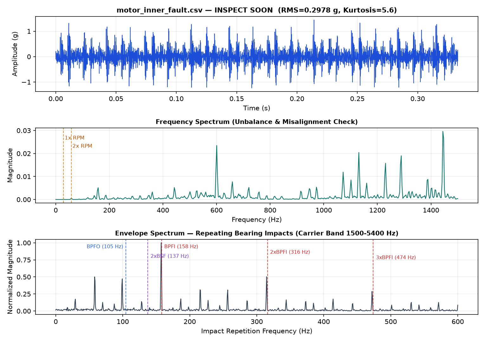
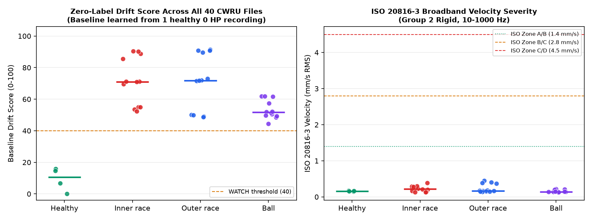
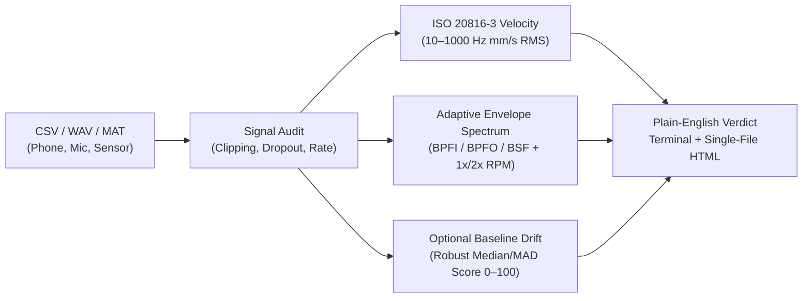

<h1 align="center">vibcheck</h1>

<p align="center">
  Point any phone, microphone, or cheap accelerometer at a spinning machine — get a plain-English health report in seconds. No AI/ML background, no cloud account, no training required.
</p>

<p align="center">
  <a href="https://github.com/aryanhood/shm-bearing-dataset/actions/workflows/ci.yml"></a>
  
  <a href="LICENSE"></a>
</p>

---

## Output First

Run `vibcheck` on any `.csv` (smartphone **Phyphox**, ESP32/Arduino MEMS sensor, DAQ), `.wav` (phone or USB mic near a fan, motor, pump, or CNC spindle), or `.mat` recording. It prints a plain-English verdict and optionally writes a shareable single-file HTML report (`--report report.html`):

```text
====================================================================
  VIBCHECK HEALTH REPORT   [INSPECT SOON]
====================================================================
  File       : motor_inner_fault.csv (accel_g, 12000 Hz, 1.50 s)
  Summary    : Fault signature or elevated vibration detected — schedule a physical inspection soon.

  Key Measurements:
    Overall RMS     : 0.2978 g   (Peak: 1.5332)
    Impulsiveness   : kurtosis 5.60  |  crest factor 5.15
    ISO 20816-3     : 0.22 mm/s RMS (Zone A, group2_rigid)
    Baseline Drift  : 54/100 vs '2 HP Shop Motor' (RMS 4.3x)
    Operating Point : 1750 RPM (29.2 Hz) | Bearing: 6205

  What We Found:
    - ISO 20816-3 vibration velocity is 0.22 mm/s RMS (Zone A — Good).
    - Mild impulsive spikes detected (kurtosis 5.6 vs ~3.0 normal baseline).
    - Drifted from '2 HP Shop Motor' baseline (score 54/100): vibration energy is 4.3x higher
      than healthy baseline; sharper repeating shocks (kurtosis 5.6 vs 2.8); noticeable shift
      in frequency content.
    - Inner race wear (BPFI) matches a repeating knock at 157.9 Hz (82.3x above local noise floor).

  What To Check Next:
    * Inspect 6205 bearing lubrication, check for roughness by hand-spinning, and plan a replacement.
====================================================================
```



### Real-World Validation (Zero Fault Labels)

To verify that `vibcheck` catches real wear without any ML training data, we learned a baseline from **one single healthy recording** (`97.mat`, 0 HP) of the Case Western Reserve University (CWRU) motor bearing dataset and scored all **40 real motor recordings** across 0–3 HP loads and 3 defect sizes:



- **40 / 40 clean separation:** every healthy run scored `0–16 / 100`, while every inner-race (`52–90`), outer-race (`49–91`), and ball (`45–62`) fault scored above `44 / 100`.
- **Why envelope + baseline drift matters:** all 40 recordings still sit inside ISO 20816-3 Zone A (`< 1.4 mm/s`) because early bearing spalls radiate at `1.5–5.5 kHz`, above ISO's `10–1,000 Hz` velocity band. Combining ISO velocity with high-frequency envelope demodulation catches both gross balance/alignment problems and early bearing wear.

---

## Try It In 10 Seconds

Only `numpy`, `scipy`, and `matplotlib` are required — no PyTorch, no GPU, no web server. Bundled real motor samples live in `examples/`:

```bash
pip install -e .

# 1. Quick health check + standalone HTML report
vibcheck check examples/motor_inner_fault.csv --rpm 1750 --bearing 6205 --report report.html

# 2. Learn YOUR machine's healthy normal (works on any fan, pump, motor, or robot joint)
vibcheck baseline examples/motor_healthy.csv -o my_motor.json --name "2 HP Shop Motor"
vibcheck check examples/motor_inner_fault.csv --baseline my_motor.json --rpm 1750 --bearing 6205

# 3. Compare before vs after a repair, grease job, or bearing swap
vibcheck compare examples/motor_inner_fault.csv examples/motor_healthy.csv --report diff.html

# 4. Look up fault frequencies for common bearings (608, 6203, 6204, 6205, 6206, 6305, ER16K)
vibcheck bearings --rpm 1750
```

### Using Your Own Phone or Sensor

- **Smartphone (free Phyphox app):** Record *Acceleration without g*, export `.csv`, and run `vibcheck check export.csv`. Sampling rate and `m/s²` units are detected automatically.
- **Phone or USB microphone:** Record 5–10 seconds of `.wav` audio near the bearing housing and run `vibcheck check motor.wav --rpm 1800 --bearing 608`.
- **ESP32 / Arduino / DAQ:** Save a 1-column or `time_s,accel_g` `.csv` and pass `--fs <Hz>` if there is no time column.

---

## How It Works



- **Universal loader ([`io.py`](vibcheck/io.py)):** Auto-detects delimiters, Phyphox headers, sampling rates, units (`g`, `m/s²`, or uncalibrated `audio`), and `.mat` channels.
- **Physics & standards ([`diagnostics.py`](vibcheck/diagnostics.py), [`bearings.py`](vibcheck/bearings.py)):** Frequency-domain integration to ISO 20816-3 `mm/s RMS` (skipped automatically on uncalibrated audio), Welch PSD for `1×` unbalance / `2×` misalignment, and kurtosis-selected Hilbert squared-envelope demodulation matched against built-in bearing geometries.
- **Personal baseline ([`baseline.py`](vibcheck/baseline.py)):** Fits a `~2 KB` median/MAD fingerprint from one healthy recording so anyone can monitor drift on any machine without knowing bearing part numbers.
- **Shareable reports ([`report.py`](vibcheck/report.py), [`compare.py`](vibcheck/compare.py)):** Emits plain-English findings, maintenance checklists, and self-contained HTML reports with embedded plots that open offline in any browser.

---

## Repository Layout

```text
shm-bearing-dataset/
├── vibcheck/              # Core library: bearings, io, diagnostics, baseline, compare, report, cli
├── examples/              # 3 small real motor sample clips (CSV + WAV) ready to run immediately
├── tests/                 # Fast unit & CLI integration tests
├── assets/                # Diagnostic report preview & 40-file CWRU zero-label validation plot
├── .github/workflows/ci.yml
├── Makefile
└── pyproject.toml
```

## References

- **ISO 20816-3:2022** — *Mechanical vibration — Measurement and evaluation of machine vibration (Industrial machines).*
- **R. B. Randall & J. Antoni**, *"Rolling element bearing diagnostics—A tutorial,"* *Mechanical Systems and Signal Processing*, 25(2):485–520, 2011.
- **Case Western Reserve University (CWRU) Bearing Data Center** — 12 kHz Drive-End SKF 6205-2RS motor vibration benchmark.

MIT License — see [LICENSE](LICENSE).
